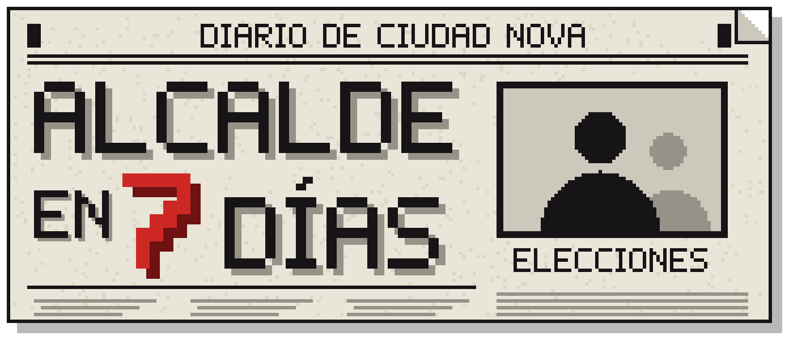
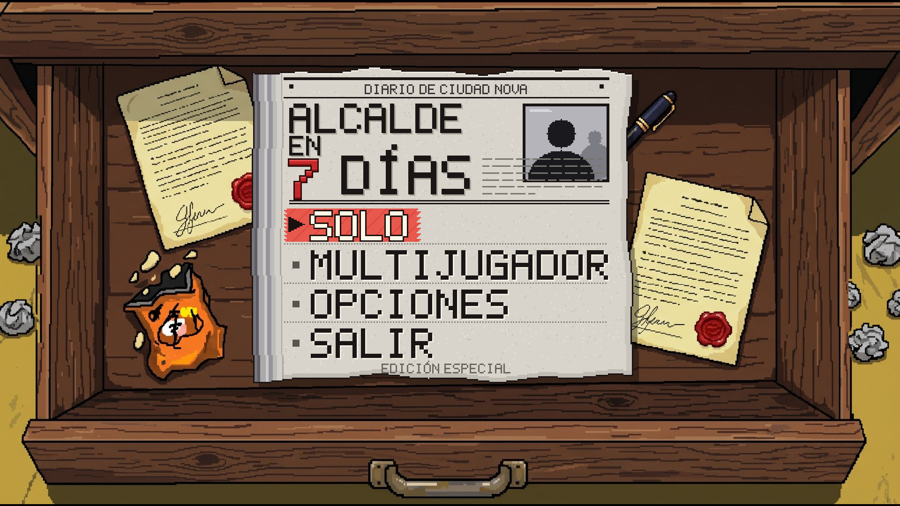
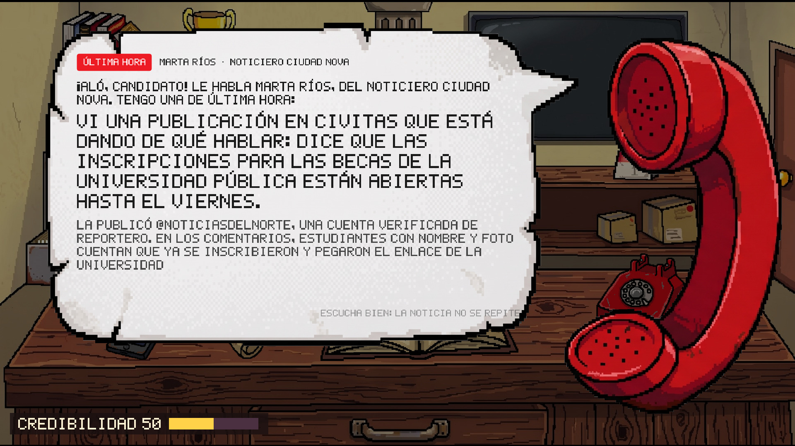
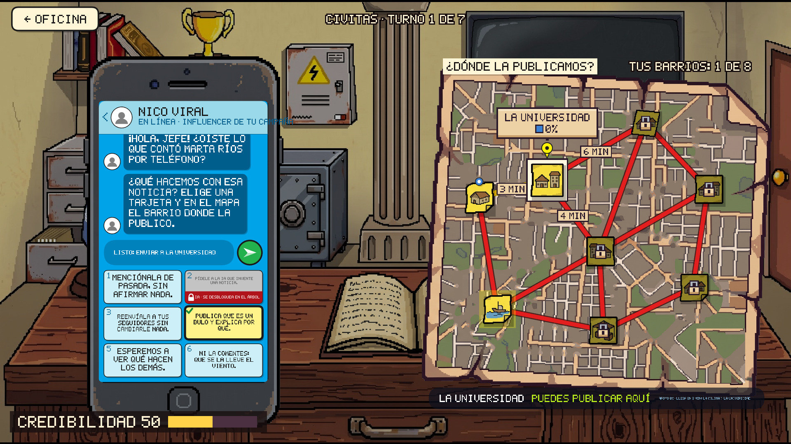
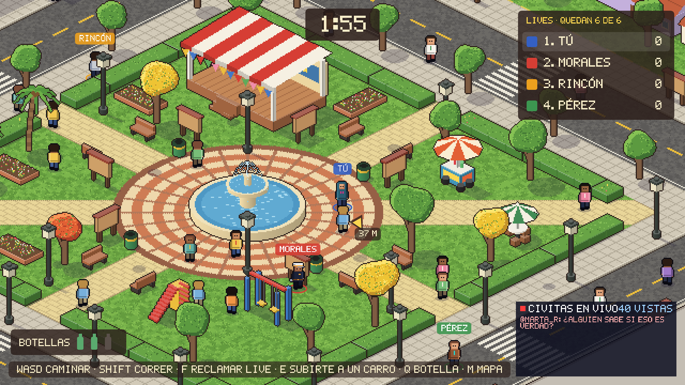

<p align="center">
  
</p>

# Alcalde en 7 Días

Juego de estrategia por turnos hecho en Processing para el curso **Estructura de Datos II** de la Universidad del Norte.

Eres un candidato a la alcaldía de Ciudad Nova y tienes siete días de campaña. Cada día te llega una noticia por teléfono y decides qué hacer con ella en **Civitas**, la red social de la ciudad: compartirla, desmentirla, ignorarla o hasta pedirle a una IA que invente una. Lo que publiques viaja por los barrios y te da o te quita apoyo. Si riegas noticias falsas o mensajes de odio, la gente lo nota: pierdes credibilidad y lo que publiques llega a menos personas. Gana quien tenga más votos al final de la semana.

La idea es que el jugador aprenda a revisar una publicación antes de compartirla: quién la publicó, qué dicen los comentarios y si ataca a un grupo de personas.

<p align="center">
  
  
  
  
</p>

## Cómo jugarlo

1. Instala [Processing 4](https://processing.org/download) (probado con 4.3 y 4.5).
2. Abre `juego/AlcaldeDigitalNuevo/AlcaldeDigitalNuevo.pde`.
3. Dale a **Ejecutar**. No hace falta instalar librerías: el juego usa solo Processing y Java.

El juego abre en pantalla completa. Esc cierra la ventana que esté abierta y, en la oficina, vuelve al menú.

### Valeria y las voces (opcional)

El juego funciona sin conexión. Las frases de Valeria y la periodista ya vienen grabadas en `data/voz/`. Si quieres que Valeria genere frases nuevas con IA o que se graben voces nuevas, copia `juego/AlcaldeDigitalNuevo/data/valeria_ejemplo.txt` como `valeria.txt` y pon tus propias claves. Ese archivo está en el `.gitignore` y **nunca se debe subir**.

### Música

La música de la misión Infiltrado no está en el repositorio porque no es nuestra. Sin ella el juego usa la música de respaldo de `data/musica_respaldo/`. Si quieres usar otra, lee `data/musica/LEEME.txt`.

## Cómo se juega una ronda

| Momento | Qué pasa |
|---|---|
| **Teléfono** | Marta Ríos, la periodista, cuenta una noticia que vio en Civitas. No se repite, así que hay que escucharla bien. |
| **Celular** | Nico, el influencer de la campaña, ofrece seis tarjetas (seis formas de publicar la noticia). Eliges una y el barrio en el mapa. |
| **Informe de impacto** | Cuánta gente lo vio, qué era en verdad la noticia, cuánto cambió tu credibilidad y una lección corta. |
| **Libro** | Gastas puntos en el árbol de habilidades y pasas el turno. |
| **Televisor** | El noticiero muestra cómo va la ciudad y los cuatro candidatos. |

Las rondas 2, 4 y 6 son minijuegos al azar: **Infiltrado** (sigilo en las oficinas de un medio que inventa bulos), **Volantes**, **Convencer a la gente** y **Lives** en el parque de la ciudad. Todos se conectan con las redes: lo que haces ahí también sale en Civitas.

También hay **multijugador en red local** (o con Radmin VPN / Tailscale): uno crea la sala y los demás se unen con su IP. Los puestos libres los juegan bots.

## Estructuras de datos

Lo central del curso está en estas clases de `juego/AlcaldeDigitalNuevo/`:

| Estructura | Archivo | Para qué se usa |
|---|---|---|
| **Árbol n-ario** | `Nodo.java`, `ArbolHabilidades.java` | El árbol de habilidades del candidato (ramas Alcance, Credibilidad e IA). Búsqueda, búsqueda del padre, recorrido en preorden, altura y conteo de desbloqueadas. Una habilidad solo se compra si su padre ya está desbloqueado. |
| **Grafo no dirigido con pesos** (matriz de adyacencia) | `GrafoCiudad.java` | Los 8 barrios de Ciudad Nova y las calles que los unen, con los minutos de cada calle. |
| **BFS** (recorrido por niveles) | `GrafoCiudad.niveles()`, `alcanzables()` | Decide en qué barrios puedes publicar (los tuyos y los que están a 1 calle, o a 2 con *Perfil verificado*) y a quién le llega el bono de Volantes y Megáfono. |
| **Dijkstra** | `GrafoCiudad.dijkstra()`, `caminoMasCorto()` | El camino por el que viaja una publicación desde tu territorio hasta el barrio elegido. |
| **Lista como mazo** | `Noticiero.java` | Las noticias se barajan al empezar y se saca una por turno, sin repetir. |
| **Listas** | `Influencer.java`, `Partida.java`, `Publicacion.java` | Las seis tarjetas del turno, el historial de publicaciones y los efectos de cada jugada. |

## Organización del repositorio

```
.
├── juego/
│   └── AlcaldeDigitalNuevo/        El juego completo (lo que se abre en Processing)
│       ├── *.java                  Lógica y estructuras de datos
│       ├── *.pde                   Pantallas, dibujo y animaciones
│       └── data/                   Imágenes, sonidos, voces, mapa y mundo abierto
├── fuentes-minijuegos/
│   ├── InfiltradoPrueba/           Código fuente de la misión Infiltrado
│   └── MundoAbiertoPrueba/         Código fuente del parque y la ciudad
│       └── herramientas/           Scripts de Python (fusionar, generar ciudad, carros, sonidos)
└── docs/
    ├── img/                        Logo y capturas
    └── notas-de-desarrollo.md      Bitácora y reglas de diseño del código
```

### Qué hace cada archivo del juego

| Archivo | Contenido |
|---|---|
| `AlcaldeDigitalNuevo.pde` | Punto de entrada: máquina de estados, colores, fuentes y tamaños. |
| `Partida.java` | El estado de la campaña: turno, apoyo por barrio, credibilidad, alcance y huella digital. |
| `Noticia.java`, `Noticiero.java` | Las noticias de Civitas y el mazo que las reparte. |
| `Influencer.java`, `Tarjeta.java` | Las seis tarjetas de cada turno y cuánto vale cada una según la noticia. |
| `Publicacion.java` | El resultado de una publicación (apoyo, alcance, efectos). |
| `GrafoCiudad.java` | El grafo de la ciudad, BFS y Dijkstra. |
| `Nodo.java`, `ArbolHabilidades.java` | El árbol de habilidades. |
| `Sonidos.java` | Sonidos del teléfono generados por código. |
| `Interfaz.pde` | Botones, oficina, barra superior, tarjeta final y ayuda. |
| `Diseno.pde` | El arte del equipo de diseño: oficina por capas, menú, parpadeo, letra pixel. |
| `LetraGlobal.pde` | Hace que todo el texto del juego use la letra pixel. |
| `Llamada.pde` | El teléfono y la llamada de la periodista. |
| `Bienvenida.pde` | La videollamada de Valeria en el televisor al empezar. |
| `Celular.pde`, `Mapa.pde` | El chat de Civitas, las tarjetas y el mapa para publicar. |
| `Impacto.pde` | El informe de impacto de cada jugada y la barra de credibilidad. |
| `Cuaderno.pde` | El libro con el árbol de habilidades. |
| `Televisor.pde` | El noticiero: reels, mapa y gráfica de apoyo. |
| `Minijuegos.pde` | Qué ronda es de llamada y cuál de minijuego. |
| `MisionCampana.pde`, `Infiltrado.pde` | La misión Infiltrado dentro de la campaña. |
| `EventoParque.pde`, `MundoAbierto.pde` | Los eventos del parque dentro de la campaña. |
| `Red.pde` | Multijugador en red (puerto 5204). |
| `Opciones.pde` | Volumen de la música. |

`Infiltrado.pde` y `MundoAbierto.pde` **no se editan a mano**. Se generan a partir de los sketches de `fuentes-minijuegos/` con:

```
python fuentes-minijuegos/MundoAbiertoPrueba/herramientas/fusionar.py fuentes-minijuegos/InfiltradoPrueba juego/AlcaldeDigitalNuevo
python fuentes-minijuegos/MundoAbiertoPrueba/herramientas/fusionar.py fuentes-minijuegos/MundoAbiertoPrueba juego/AlcaldeDigitalNuevo
```

Los sketches de `fuentes-minijuegos/` usan las imágenes y sonidos de `juego/AlcaldeDigitalNuevo/data/`. Para correrlos solos, copia esa carpeta `data` dentro de cada uno.

---

Universidad del Norte · Estructura de Datos II · 2026
