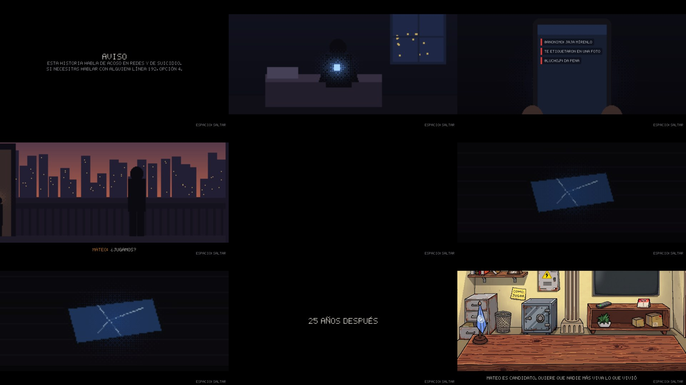
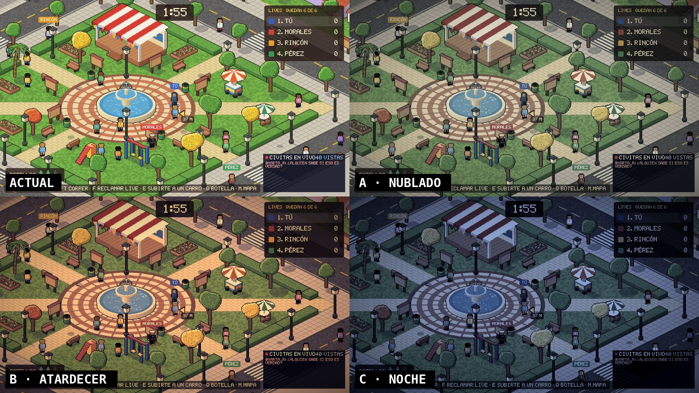

# Guía de personajes y cinemáticas

Esta guía es para el equipo de diseño. Dice qué tamaño, qué archivos y qué reglas necesita el juego para que los dibujos nuevos entren sin tocar código.

## Dos tamaños por personaje

Hoy Valeria es un dibujo de 20x20 pixeles agrandado a media pantalla, y por eso se ve mal: no hay pixeles suficientes para una cara. Los juegos que cuentan historias en pixel art (VA-11 Hall-A, Katana Zero, Eastward) separan los dos usos:

| Uso | Tamaño | Dónde sale |
|---|---|---|
| Sprite de mundo | 16 a 48 px de alto | Mundo abierto, Infiltrado. Se reconoce por la silueta y la ropa, no por la cara. |
| Retrato | 128 px de alto (ancho libre, entre 96 y 128) | Videollamada de Valeria, llamadas, cinemáticas. Aquí sí se ven las emociones. |

## Archivos del retrato

Van en `juego/AlcaldeEn7Dias/data/retratos/`, en PNG con fondo transparente, todos del mismo tamaño y con la cabeza en el mismo lugar:

| Archivo | Qué es |
|---|---|
| `<nombre>_base.png` | Boca cerrada, ojos abiertos |
| `<nombre>_habla.png` | Boca abierta (cuando habla, el juego alterna base y habla) |
| `<nombre>_parpadeo.png` | Ojos cerrados (el juego parpadea cada tres o cuatro segundos) |
| `<nombre>_triste.png`, `_enojada.png`, `_preocupada.png`, `_sonrie.png` | Opcionales, para las escenas |

Valeria ya está conectada: en cuanto exista `retratos/valeria_base.png`, la videollamada usa el retrato nuevo. Si falta `_habla` o `_parpadeo`, se usa la base.

## Reglas para que se vea bien

- **Sin suavizado.** Nada de antialias ni desenfoque. Cada pixel es de un solo color y totalmente opaco o totalmente transparente.
- **Paleta corta.** Entre 16 y 24 colores por personaje. Cada material (piel, pelo, ropa) con una rampa de 4 o 5 tonos.
- **Sombras frías, luces cálidas.** Las sombras tiran un poco a azul o morado y las luces a amarillo. Queda más vivo que oscurecer con negro.
- **Contorno oscuro, no negro puro.** Un tono oscuro del color de al lado.
- **Luz desde arriba a la izquierda** en todos los retratos, para que combinen entre sí.
- **Rasgos exagerados.** En pocos pixeles, lo que define al personaje tiene que ser grande: el pelo de Valeria, los audífonos, la expresión.

## Personajes que necesitan retrato

| Personaje | Quién es | Prioridad |
|---|---|---|
| Valeria | La estratega digital de la campaña | Alta (sale al empezar) |
| Marta Ríos | La periodista que llama cada día | Alta |
| Mateo adulto | El candidato, el protagonista | Alta |
| Andrés | El hermano mayor, en el prólogo | Alta |
| Mateo niño | En el prólogo | Media |
| Nico Viral | El influencer del celular | Media |
| Morales, Rincón, Pérez | Los otros candidatos | Baja |

## Cinemáticas

Las escenas se arman en `data/cinematicas/<escena>.txt` y los dibujos van en `data/cinematicas/<escena>/`. El lienzo es de **320x180** y el juego lo agranda a la pantalla.

- **Una capa por cosa que se mueve o aparece.** Por ejemplo, el fondo del balcón en un archivo y Mateo en la puerta en otro, para que el niño aparezca después.
- **Mismo nombre, mismo tamaño.** Los dibujos de `prologo/` hoy son bocetos. Para reemplazarlos basta con guardar el dibujo definitivo con el mismo nombre.
- **El archivo de la escena se edita como texto.** Ahí se cambian los tiempos, los movimientos de cámara, los subtítulos y los sonidos. Las órdenes están explicadas al principio de `Cinematica.pde`.



Un plano de ejemplo:

```
plano 5600
capa prologo/balcon.png 0 0
capa prologo/mateo_puerta.png 0 0 1200
camara 200 108 1.15 150 100 1.0
subtitulo 1600 Mateo|¿Jugamos?
fundido 500 120
```

Esto dura 5,6 segundos y Mateo aparece a los 1,2. La cámara va de cerca a lejos y el subtítulo sale a los 1,6.

## Color del mundo abierto

Los dibujos del mundo abierto tienen una paleta más profunda que la original: verde bosque en vez de verde lima, piedra en vez de crema, ladrillo oscuro, sombras que tiran a azul. Sale de `herramientas/recolorear_mundo.py` (nivel 1.4) aplicado a los originales de `arte/originales/mundo/`. Si se dibuja algo nuevo para el mundo, se guarda en esa carpeta con sus colores normales y se vuelve a correr el script; así queda igual al resto.

### Tinte opcional

Además de la paleta, el juego puede teñir la pantalla con un shader (`Ambiente.pde`). Viene apagado; sirve para escenas puntuales, como una noche.



- **F8 dentro del mundo abierto** cambia entre los ambientes: ninguno, nublado, atardecer y noche. El elegido queda guardado.
- **El rojo se reserva** para lo que tiene que ver con odio y bulos. El HUD, los avisos y Civitas en vivo se dibujan después del tinte, así que ahí el rojo resalta contra una ciudad apagada. Conviene no usarlo en la decoración del mundo.
- **`herramientas/ambiente_pruebas.py`** prueba un ambiente sobre una captura sin abrir el juego.
